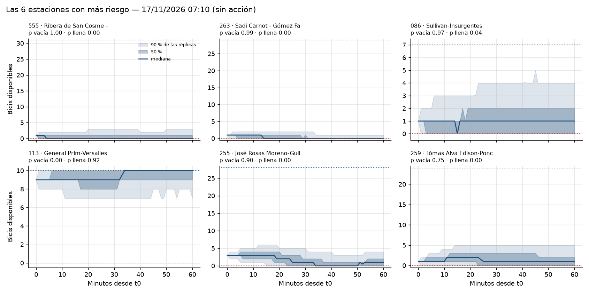

# Gemelo digital Ecobici · en vivo

Página actualizada automáticamente el 17/11/2026 07:10 (hora de Ciudad de México).

## Último pronóstico: 17/11 07:10 a 08:10

### Clima de la hora y su efecto en la demanda

**11.3 °C** · sin lluvia · viento 4 km/h · día hábil

El clima multiplica los **retiros por 0.91** y las **devoluciones por 0.92** (1,00 = sin efecto).

| Variable | Condición | Factor retiros | Factor devoluciones |
| --- | --- | --- | --- |
| lluvia | sin lluvia | 0.988 | 0.981 |
| lluvia previa | seco antes | 0.990 | 1.001 |
| temperatura | normal (±1 °C) | 0.944 | 0.951 |
| viento | < 5 km/h | 0.988 | 0.985 |

| Estación | Bicis / capacidad | P(vacía) | P(llena) | Bicis en 1 h (IC 80 %) |
| --- | --- | --- | --- | --- |
| 107-108 Tolsa-Balderas | 0 / 52 | 1.00 | 0.00 | 0-1 |
| 118 Liverpool-Dinamarca | 16 / 16 | 0.00 | 1.00 | 12-16 |
| 555 Ribera de San Cosme - Insurg | 1 / 31 | 1.00 | 0.00 | 0-2 |
| 270 De la República-Ponciano Arr | 0 / 28 | 1.00 | 0.00 | 0-5 |
| 263 Sadi Carnot - Gómez Farias | 1 / 29 | 0.99 | 0.00 | 0-1 |
| 098 Emilio Dondé-Av. Balderas | 0 / 19 | 0.99 | 0.00 | 0-3 |
| 116 Londres-Roma | 18 / 18 | 0.00 | 0.97 | 13-18 |
| 086 Sullivan-Insurgentes | 1 / 7 | 0.97 | 0.04 | 0-3 |
| 010 Reforma - Ramírez | 27 / 27 | 0.02 | 0.96 | 7-23 |
| 113 General Prim-Versalles | 9 / 10 | 0.00 | 0.92 | 8-10 |

### Plan recomendado del camión

1. Llevar **16 bicis** de 118 (16/16) a 107-108 (0/52)
2. Llevar **15 bicis** de 116 (18/18) a 555 (1/31)
3. Llevar **8 bicis** de 113 (9/10) a 263 (1/29)

## ¿Qué tan bien pronostica? (pronósticos hechos en tiempo real, ya evaluados)

15 pronósticos evaluados contra lo que ocurrió una hora después (sin estaciones con camión del operador). Menor es mejor; decir siempre 50 % da 0,25.

| Modelo | Brier vacía | Brier llena |
| --- | --- | --- |
| Gemelo | 0.098 | 0.098 |
| Sin resincronizar | 0.121 | 0.091 |
| Persistencia | 0.231 | 0.154 |
| Persistencia 0/1 | 0.231 | 0.154 |

## Detalle

Archivos: `pronosticos.csv` (cada pronóstico), `evaluaciones.csv` (lo que ocurrió), `resumen_vivo.csv` (puntajes), `ultimo/` (tablas y resumen del último ciclo).
