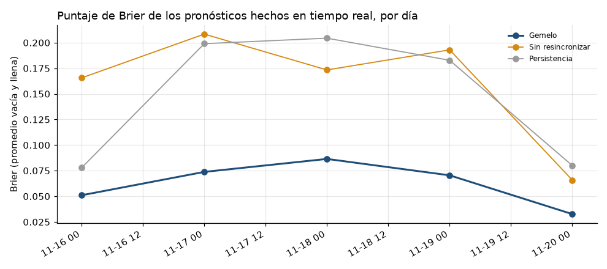

# Gemelo digital Ecobici · en vivo

Página actualizada automáticamente el 20/11/2026 07:08 (hora de Ciudad de México).

## Último pronóstico: 20/11 07:08 a 08:08

### Clima pronosticado de la hora y su efecto en la demanda

_La hora todavía no termina: el clima es el pronóstico meteorológico (Open-Meteo)._

**9.9 °C** · sin lluvia · viento 2 km/h · día hábil

El clima multiplica los **retiros por 0.81** y las **devoluciones por 0.84** (1,00 = sin efecto).

| Variable | Condición | Factor retiros | Factor devoluciones |
| --- | --- | --- | --- |
| lluvia | sin lluvia | 0.988 | 0.981 |
| lluvia previa | seco antes | 0.990 | 1.001 |
| temperatura | más frío (−3 a −1 °C) | 0.841 | 0.872 |
| viento | < 5 km/h | 0.988 | 0.985 |

| Estación | Bicis / capacidad | P(vacía) | P(llena) | Bicis en 1 h (IC 80 %) |
| --- | --- | --- | --- | --- |
| 119 Turín-Abraham González | 0 / 5 | 1.00 | 0.00 | 0-0 |
| 012 Río Lerma - Villalongín | 11 / 11 | 0.02 | 0.98 | 4-11 |
| 555 Ribera de San Cosme - Insurg | 4 / 23 | 0.96 | 0.00 | 0-3 |
| 263 Sadi Carnot - Gómez Farias | 3 / 28 | 0.84 | 0.00 | 0-2 |
| 086 Sullivan-Insurgentes | 3 / 16 | 0.76 | 0.00 | 0-5 |
| 118 Liverpool-Dinamarca | 11 / 19 | 0.00 | 0.70 | 13-19 |
| 114 Lucerna-Abraham González | 1 / 21 | 0.69 | 0.00 | 0-4 |
| 048 Independencia - Azueta | 1 / 11 | 0.68 | 0.00 | 0-3 |
| 003 Reforma - Insurgentes | 1 / 30 | 0.66 | 0.00 | 0-5 |
| 020 Reforma- Río Támesis | 1 / 19 | 0.53 | 0.00 | 1-11 |

### Plan recomendado del camión

1. Llevar **11 bicis** de 118 (11/19) a 555 (4/23)
2. Llevar **6 bicis** de 012 (11/11) a 263 (3/28)
3. Llevar **9 bicis** de 259 (20/25) a 086 (3/16)

## ¿Qué tan bien pronostica? (pronósticos hechos en tiempo real, ya evaluados)

228 pronósticos evaluados contra lo que ocurrió una hora después (sin estaciones con camión del operador). Menor es mejor; decir siempre 50 % da 0,25.

| Modelo | Brier vacía | Brier llena |
| --- | --- | --- |
| Gemelo | 0.119 | 0.035 |
| Sin resincronizar | 0.288 | 0.095 |
| Persistencia | 0.325 | 0.064 |
| Persistencia 0/1 | 0.325 | 0.064 |

## Detalle

Archivos: `pronosticos.csv` (cada pronóstico), `evaluaciones.csv` (lo que ocurrió), `resumen_vivo.csv` (puntajes), `ultimo/` (tablas y resumen del último ciclo).
