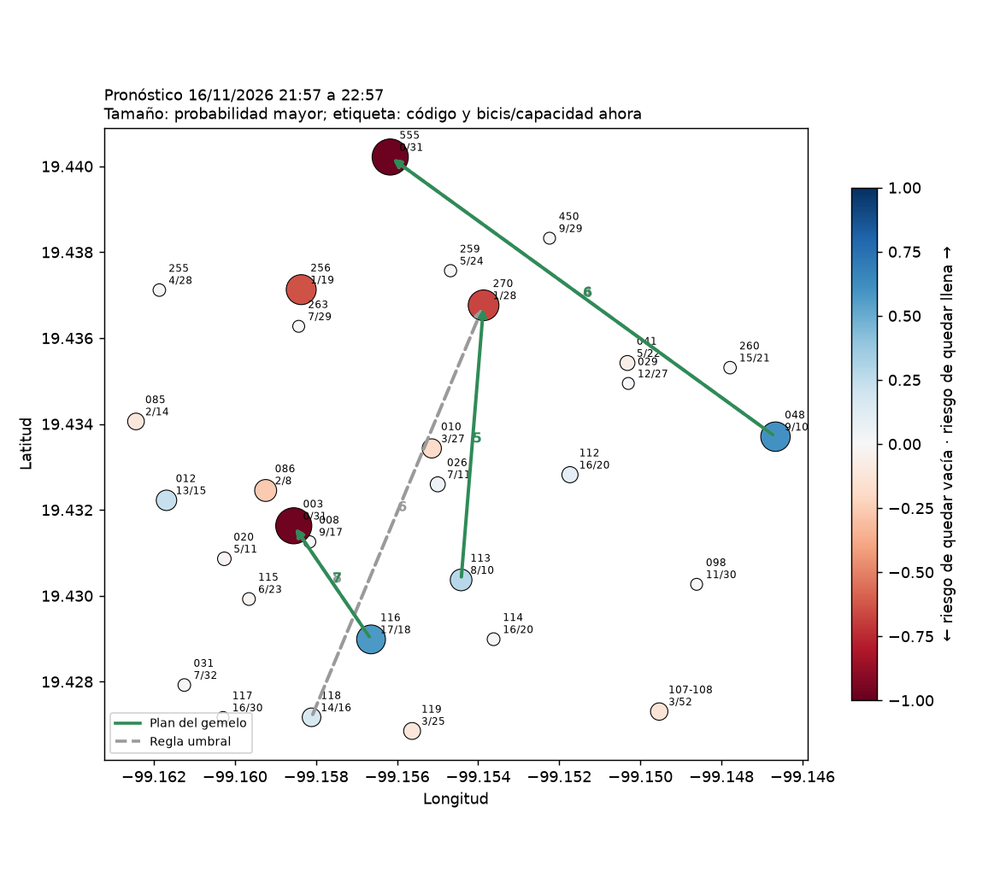

# Gemelo digital Ecobici · en vivo

Página actualizada automáticamente el 16/11/2026 21:57 (hora de Ciudad de México).

## Último pronóstico: 16/11 21:57 a 22:57

### Clima de la hora y su efecto en la demanda

**13.8 °C** · sin lluvia · viento 9 km/h · día fin de semana

El clima multiplica los **retiros por 0.78** y las **devoluciones por 0.84** (1,00 = sin efecto).

| Variable | Condición | Factor retiros | Factor devoluciones |
| --- | --- | --- | --- |
| lluvia | sin lluvia | 0.991 | 0.996 |
| lluvia previa | seco antes | 1.006 | 1.009 |
| temperatura | más frío (−3 a −1 °C) | 0.843 | 0.875 |
| viento | 5-10 km/h | 0.930 | 0.955 |

| Estación | Bicis / capacidad | P(vacía) | P(llena) | Bicis en 1 h (IC 80 %) |
| --- | --- | --- | --- | --- |
| 555 Ribera de San Cosme - Insurg | 0 / 31 | 0.98 | 0.00 | 0-3 |
| 003 Reforma - Insurgentes | 0 / 31 | 0.98 | 0.00 | 0-4 |
| 270 De la República-Ponciano Arr | 1 / 28 | 0.67 | 0.00 | 0-4 |
| 256 Gómez Farías-Sadi Carnot | 1 / 19 | 0.64 | 0.00 | 0-3 |
| 048 Independencia - Azueta | 9 / 10 | 0.00 | 0.61 | 7-10 |
| 116 Londres-Roma | 17 / 18 | 0.00 | 0.58 | 13-18 |
| 086 Sullivan-Insurgentes | 2 / 8 | 0.28 | 0.03 | 0-6 |
| 113 General Prim-Versalles | 8 / 10 | 0.00 | 0.28 | 6-10 |
| 012 Río Lerma - Villalongín | 13 / 15 | 0.00 | 0.23 | 11-15 |
| 010 Reforma - Ramírez | 3 / 27 | 0.19 | 0.00 | 0-6 |

### Plan recomendado del camión

1. Llevar **6 bicis** de 048 (9/10) a 555 (0/31)
2. Llevar **7 bicis** de 116 (17/18) a 003 (0/31)
3. Llevar **5 bicis** de 113 (8/10) a 270 (1/28)

## ¿Qué tan bien pronostica? (pronósticos hechos en tiempo real, ya evaluados)

6 pronósticos evaluados contra lo que ocurrió una hora después (sin estaciones con camión del operador). Menor es mejor; decir siempre 50 % da 0,25.

| Modelo | Brier vacía | Brier llena |
| --- | --- | --- |
| Gemelo | nan | nan |
| Sin resincronizar | nan | nan |
| Persistencia | nan | nan |
| Persistencia 0/1 | nan | nan |

## Detalle

Archivos: `pronosticos.csv` (cada pronóstico), `evaluaciones.csv` (lo que ocurrió), `resumen_vivo.csv` (puntajes), `ultimo/` (tablas y resumen del último ciclo).
